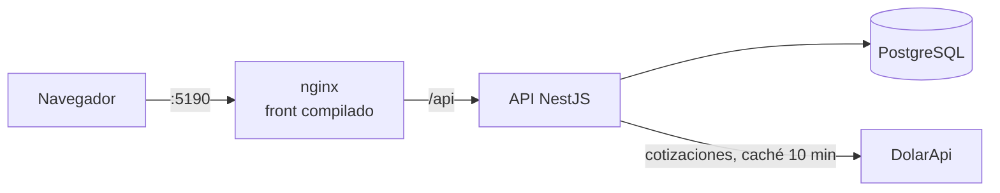

# Gastos fijos

[](https://github.com/MirandaGonzalo/gastos-fijos/actions/workflows/frontend.yml)
[](https://github.com/MirandaGonzalo/gastos-fijos/actions/workflows/backend.yml)
[](https://github.com/MirandaGonzalo/gastos-fijos/actions/workflows/docker.yml)

App full stack para llevar el control de los **gastos fijos del mes**: qué se debita solo, qué hay que pagar antes de que venza, cuánto pagaste cada mes y **cuánto fue subiendo cada servicio**. Pensada para Argentina: pesos y dólares, con la cotización real a la que compraste.

<!-- Captura principal:  -->

## Qué hace

- **Inicio**: el próximo vencimiento, cuánto pagaste y cuánto falta este mes, y la comparación con el mes anterior.
- **Pagos**: los cargos del mes agrupados en *requieren atención*, *próximos* y *pagados*. Se registra el monto real y, en dólares, la cotización a la que se compró.
- **Calendario**: la grilla del mes con cada pago en su día, diferenciando débitos automáticos y vencimientos manuales.
- **Análisis**: total pagado en el período, gasto mes a mes por categoría y cuánto subió cada servicio (variación total y mensual).
- **Gastos**: alta, edición y baja, con reglas que protegen el historial (un gasto con pagos no se borra: se da de baja).
- **Cotización del dólar** en vivo desde [DolarApi](https://dolarapi.com), con caché y fallback.

<!-- Capturas: Pagos, Calendario y Análisis en docs/capturas/ -->

## Stack

| | |
|---|---|
| **Frontend** | React 19 · TypeScript · Vite · React Router · Tailwind CSS · Recharts · Vitest |
| **Backend** | NestJS 11 · Prisma 7 · PostgreSQL 17 · class-validator · Swagger · Jest |
| **Infra** | Docker · Docker Compose · nginx · GitHub Actions · Dependabot |

## Arquitectura



En producción, nginx sirve el front y redirige `/api` al back: mismo origen, sin CORS, y la API no publica puertos.

### Decisiones de diseño

- **Plantilla y cargos mensuales.** Un `FixedExpense` es la regla ("la luz vence el 15, ronda los $80.000"); un `MonthlyCharge` es lo que pasó un mes concreto (monto real, vencimiento, estado). Así el historial no depende de la plantilla.
- **Generación *lazy* de cargos.** Los cargos se crean cuando se consulta un rango de meses (`GET /charges?from&to`), con `createMany` + `skipDuplicates`. Un gasto "sin fecha de fin" no genera meses infinitos, y lo ya ajustado no se pisa.
- **Débito automático vs. pago manual.** La misma fecha significa cosas distintas: cuándo te debitan o hasta cuándo podés pagar. Cambia los estados, las alertas y los textos.
- **Dinero en `Decimal(12,2)`**, nunca `float`. Los pagos en USD guardan la cotización real de compra, así el análisis refleja lo que costaron en pesos.
- **Ediciones que protegen el historial**, dentro de una transacción: cambiar el día o el monto estimado solo afecta a lo pendiente desde el mes actual, respetando los montos ajustados a mano; no se puede cambiar la moneda ni la vigencia si deja pagos afuera.
- **Lógica de negocio en funciones puras** (`frontend/src/utils`): estados de pago, resumen del inicio, análisis y calendario se testean sin React.
- **Usuario de solo lectura** en Postgres para herramientas externas (por ejemplo, el MCP de Claude Code): la restricción la aplica la base, no la herramienta.

## Cómo levantarlo

Requisitos: Docker y Docker Compose.

```bash
# La app con datos de demo (base aparte, se regenera en cada arranque)
docker compose --profile demo up -d --build
# -> http://localhost:5191

# La app con tus datos
docker compose --profile app up -d --build
# -> http://localhost:5190
```

En Windows también está `iniciar-gastos.cmd`, que abre Docker si hace falta, reconstruye solo si cambió el código y abre el navegador. `crear-acceso-directo.cmd` lo deja en el escritorio.

### Desarrollo

```bash
docker compose up -d              # solo Postgres (puerto 5433)

cd backend
cp .env.example .env
npm install
npx prisma migrate dev
npx prisma db seed                # categorías y medios de pago por defecto
npm run start:dev                 # http://localhost:3100 · Swagger en /docs

cd ../frontend
cp .env.example .env
npm install
npm run dev                       # http://localhost:5180
```

## Calidad y CI

| Workflow | Qué verifica |
|---|---|
| **Frontend CI** | ESLint, TypeScript, tests con Vitest y build de producción |
| **Backend CI** | ESLint, TypeScript, tests con Jest, migraciones sobre un Postgres limpio, seed de demo y *smoke test* de la API levantada |
| **Docker** | Build de las imágenes (con caché) y el stack completo en modo demo, probado de punta a punta a través de nginx |

Cada workflow corre solo cuando cambia su parte del monorepo. Dependabot mantiene las dependencias al día.

```bash
cd frontend && npm test           # Vitest
cd backend && npm test            # Jest
```

## Estructura

```
├── frontend/            React + Vite
│   └── src/
│       ├── api/         llamadas al back
│       ├── hooks/       estado de cada recurso (datos, carga, error)
│       ├── pages/       una por pantalla
│       ├── components/
│       ├── context/     cotización del dólar compartida
│       └── utils/       lógica de negocio pura (+ tests)
├── backend/             NestJS + Prisma
│   ├── src/             controllers · services · modules · dto · utils
│   └── prisma/          schema, migraciones, seeds e importador de historial
├── db/                  scripts de Postgres (rol de solo lectura)
└── docker-compose.yml   perfiles: base sola, app, demo
```
