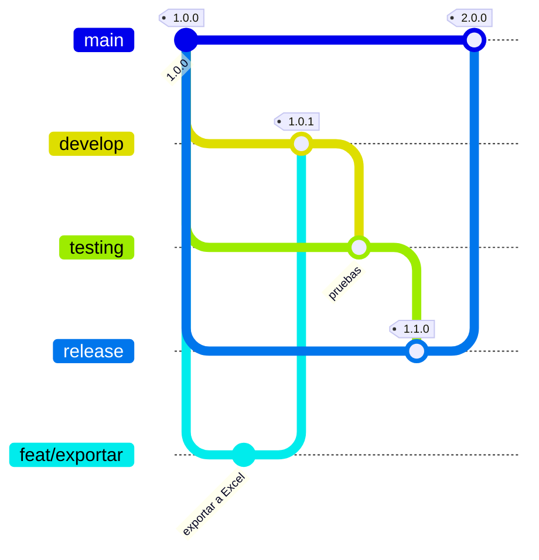

# Flujo de ramas y versionado



## Ramas

| Rama | Para qué | Versión que genera | CI que corre |
|---|---|---|---|
| `feat/*`, `fix/*`, `docs/*`, `ci/*` | Un cambio puntual. Sale de `develop` y vuelve por PR | — | Lint, tipos, tests y build en el PR |
| `develop` | Integración del desarrollo diario | **patch**: `1.0.1` | Lint, tipos, tests y build |
| `testing` | Pruebas intensivas antes de liberar | — | Lo anterior + imágenes Docker + stack completo de punta a punta |
| `release` | Lo que se despliega en el entorno de despliegue (futuro) | **minor**: `1.1.0` + GitHub Release *pre-release* | Todo |
| `main` | Versión estable | **major**: `2.0.0` + GitHub Release | Todo |

Los cambios avanzan siempre en el mismo sentido, por Pull Request:

```
feat/*  →  develop  →  testing  →  release  →  main
```

## Día a día

```bash
git switch develop && git pull
git switch -c feat/nombre-del-cambio
# ... cambios y commits ...
git push -u origin feat/nombre-del-cambio
# PR hacia develop -> CI en verde -> Squash and merge
```

Para promover entre entornos se abre un PR de `develop` a `testing`, de `testing` a `release` y de `release` a `main`, usando **"Create a merge commit"** (no squash) para que las ramas no se desincronicen.

## Versionado

El workflow `versionado.yml` toma el último tag `x.y.z` y lo incrementa según la rama que recibió el push. Usa el token propio de GitHub Actions: no hace falta configurar secretos.

Nombres de commits sugeridos ([Conventional Commits](https://www.conventionalcommits.org/es/)): `feat:`, `fix:`, `docs:`, `ci:`, `test:`, `refactor:`, `chore:`. Las notas de cada GitHub Release se arman solas con los títulos de los PRs.
